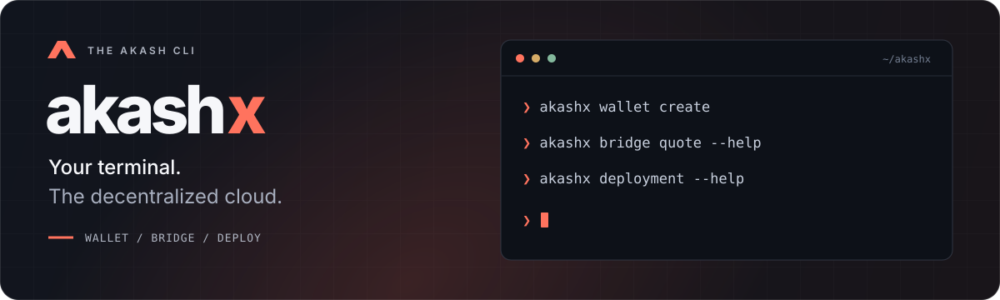

<p align="center">
  
</p>

<p align="center">
  <strong>Akash wallets, cross-chain funding, and tenant deployments. From your terminal.</strong>
</p>

<p align="center">
  <a href="https://github.com/TomasH60/akashx/actions/workflows/test.yml"></a>
  <a href="https://github.com/TomasH60/akashx/actions/workflows/checks.yml"></a>
  <a href="https://github.com/TomasH60/akashx/actions/workflows/docs.yml"></a>
</p>

<p align="center">
  <a href="https://tomash60.github.io/akashx/"><strong>Documentation</strong></a> &nbsp;·&nbsp;
  <a href="https://tomash60.github.io/akashx/getting-started/">Getting started</a> &nbsp;·&nbsp;
  <a href="https://tomash60.github.io/akashx/commands/">Command reference</a> &nbsp;·&nbsp;
  <a href="https://github.com/TomasH60/akashx/issues">Report an issue</a>
</p>

---

| Wallet                                               | Bridge                                                     | Deploy                                                  |
| :--------------------------------------------------- | :--------------------------------------------------------- | :------------------------------------------------------ |
| Create encrypted local wallets and inspect balances. | Quote, send, and track cross-chain routes through Skip Go. | Manage SDL, bids, leases, manifests, logs, and cleanup. |

### Quick start

Requires **Node.js 22.18+ (22.x) or 24.x**.

```sh
git clone https://github.com/TomasH60/akashx.git
cd akashx
npm ci
npm run build
npm link

akashx --help
```

### Explore

```sh
akashx config show
akashx wallet --help
akashx bridge --help
akashx deployment --help
```

> **In development.** Tenant commands default to `sandbox-2`. Start with the
> [deployment guide](https://tomash60.github.io/akashx/guides/tenant-cli/) or the
> [testnet bridge walkthrough](https://tomash60.github.io/akashx/guides/testnet-bridge/).

[Development guide](https://tomash60.github.io/akashx/development/) · [Run the docs locally](website/README.md)
